# OneDraft

An AI-native desktop app for posting everywhere from one draft.
Bring your footage (or just an idea), let Claude cut it by what you say and caption it, tailor the post for
each platform, approve it, and OneDraft publishes or schedules it everywhere — YouTube, Bilibili, Rednote,
Instagram, TikTok and X built in, and any other platform through a plugin or an MCP server. Then answer the
comments from one Inbox.

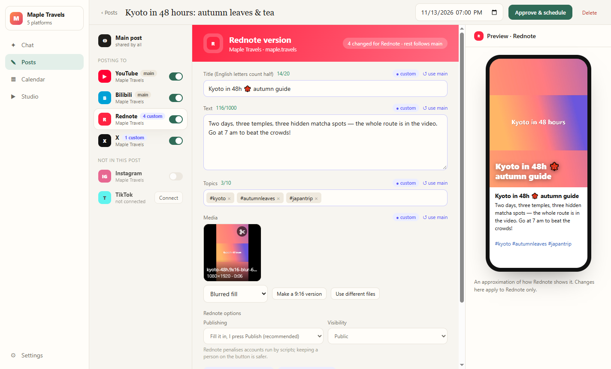

## How you use it

- **One you, one account per platform.** Connect your YouTube, Rednote, Bilibili, Instagram, TikTok and X in
  Settings → Platforms. Signing in with a different account replaces the old one.
- **Chat** is home: ask Claude for a post, an edit or a new video ("cut the ums and retakes from this, make a
  45-second vertical version with captions, and post it to TikTok and Rednote"). Nothing goes out until you approve.
- **Studio** edits your own videos by what is said: transcribe a clip (Whisper, on your PC), then delete words in
  the text, drop filler words and shorten pauses, fix misheard words, and add word-by-word captions. The preview
  plays the whole edit (cuts, captions, text, shape) before you render, with a timeline strip, split at the
  playhead (S), undo (Ctrl+Z) and the usual playback keys. Claude does the same from Chat.
- **Posts** opens the editor. The **main post** is shared by every platform; click a platform on the left to
  open its own panel. Fields it hasn't changed follow the main post (*↳ from main*); edit one and it becomes
  *● custom* for that platform only; *↺ use main* puts it back. The right side previews how that platform shows it.
- **Inbox** gathers the comments on your YouTube, X and Instagram posts. Answer them in place, or let Claude
  draft replies (✨); nothing is sent until you press *Send reply*. It looks for new ones when you open it and every
  30 minutes in the background (or only when you ask). TikTok, Bilibili and Rednote don't let apps read comments.
- **Numbers**: published posts show their views, likes and comments, added up on the Posts list and per platform
  in the editor (with a *Comments* link to that post's comments).
- **Calendar** shows the week's scheduled and published posts.

| | |
|---|---|
| 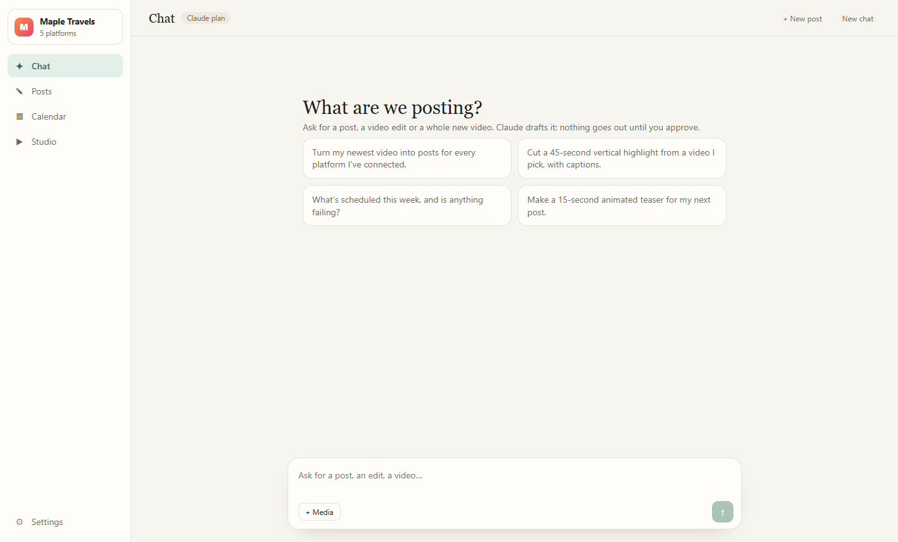 | 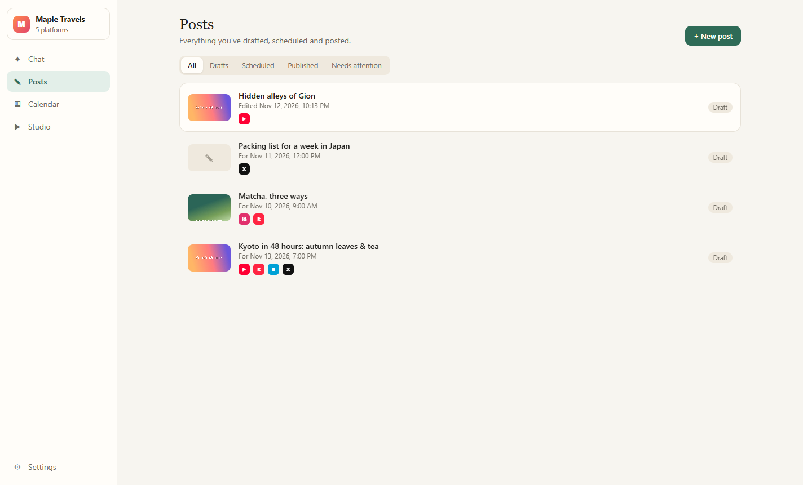 |
| 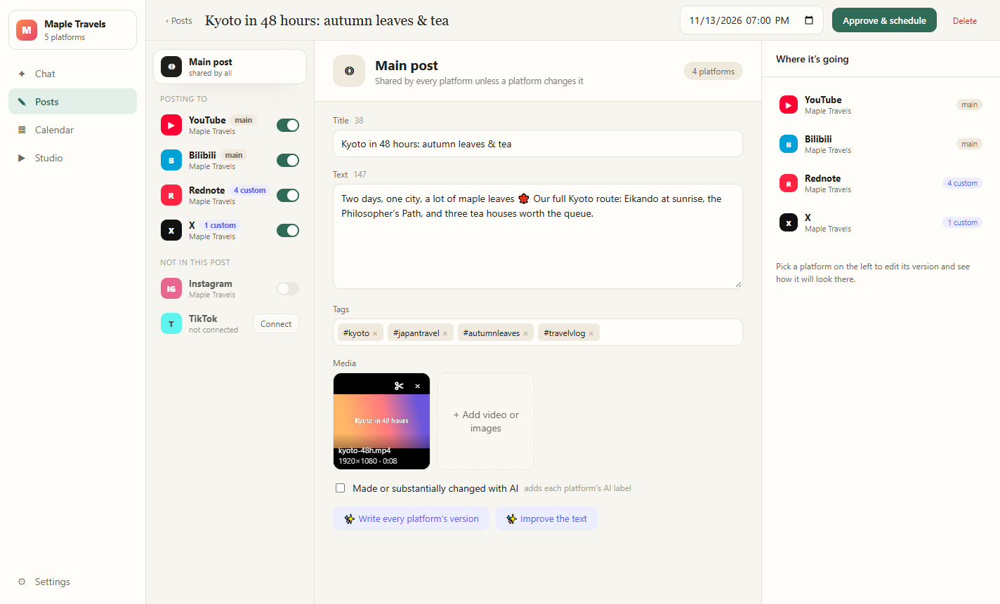 | 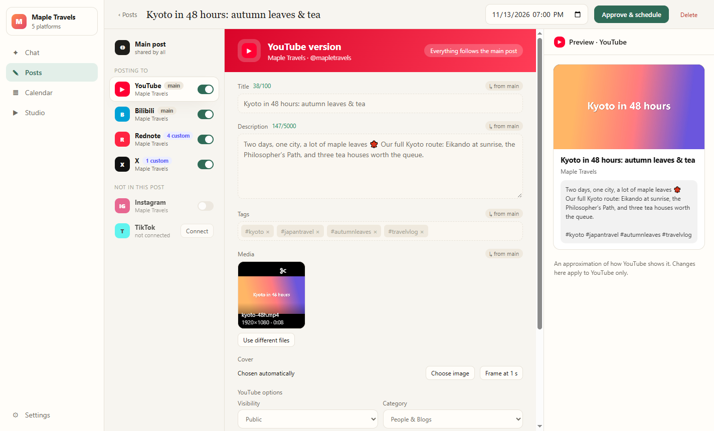 |
| 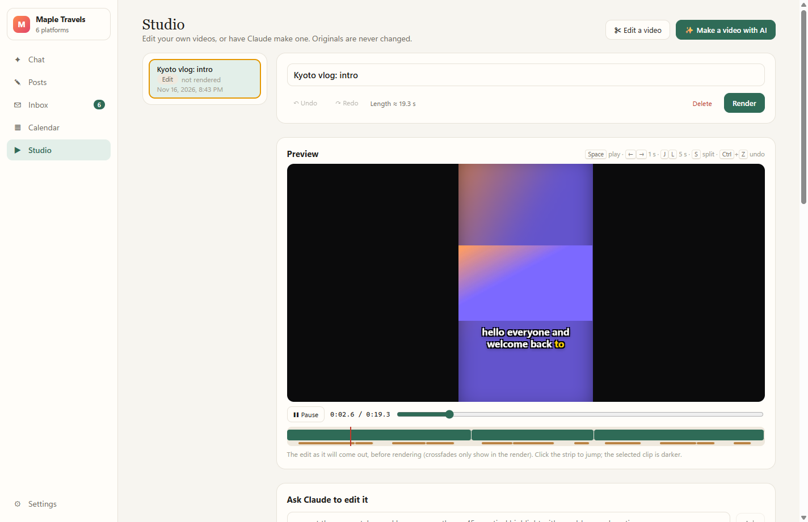 | 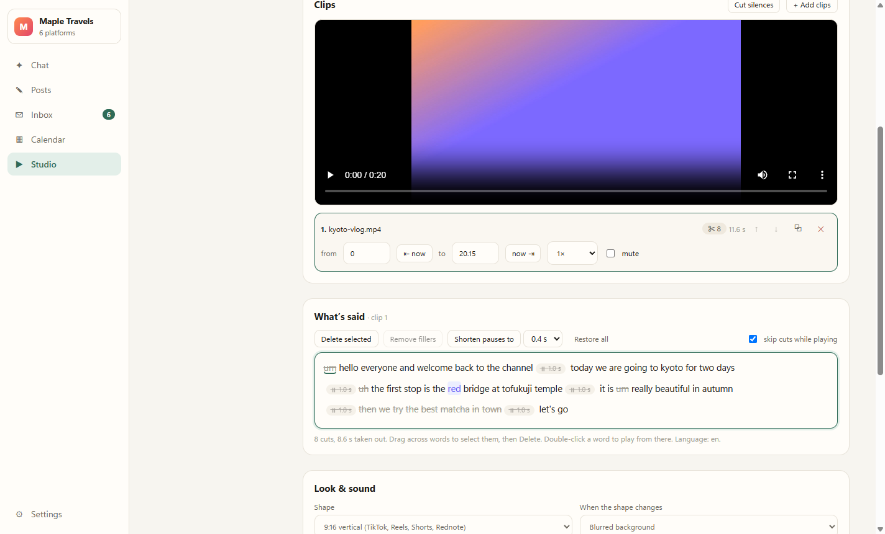 |
| 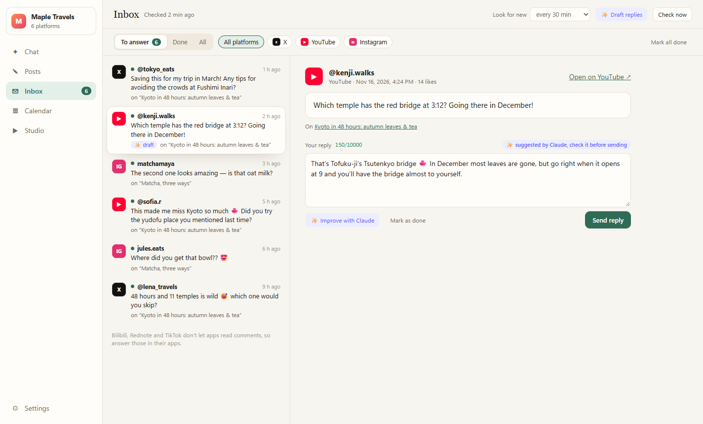 | 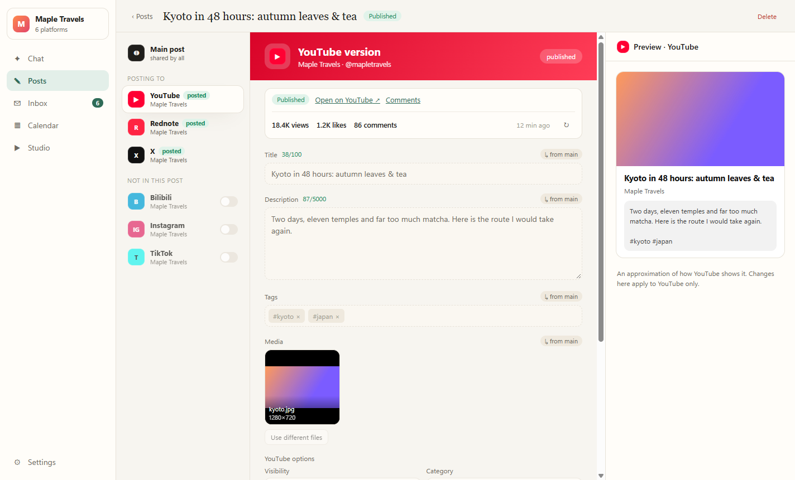 |
| 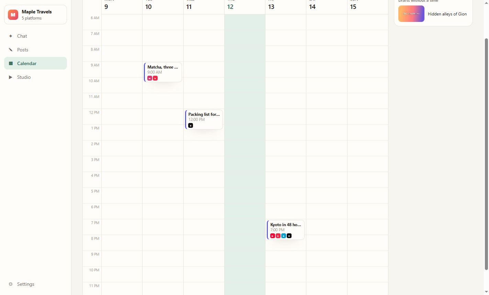 | 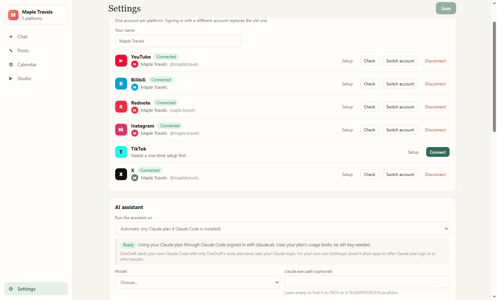 |

## Install it

Download **`OneDraft-Setup-<version>.exe`** from the [latest release](https://github.com/Houchen181/onedraft/releases/latest)
(Windows 10/11, 64-bit) and double-click it: it installs for your Windows account (no admin), adds Start-menu and
desktop shortcuts and opens OneDraft. The installer isn't code-signed, so the first time Windows SmartScreen says
*Windows protected your PC*: choose **More info → Run anyway**. Installing a newer version replaces the old one and
keeps your data; uninstalling (Settings → Apps) keeps it too.

To have scheduled posts go out after a restart without opening OneDraft yourself, turn on
Settings → App → *Start OneDraft in the tray when you sign in to Windows*.

Build the installer yourself with `npm install` then `npm run dist` (→ `dist\OneDraft-Setup-<version>.exe`).

**Releasing a version:** set `version` in `package.json`, commit, then tag it with the release notes as the
message and push the tag (`git tag -a v0.2.0 -m "…"` then `git push origin v0.2.0`). GitHub Actions
(`.github/workflows/release.yml`) tests it, builds the installer and publishes the release.

## Run it from source

```bash
npm install
npm run dev        # development, with hot reload
npm run build && npm start   # production build
npm test           # core tests (validation, publish state machine, inbox, media, OAuth, signing)
```

Windows 10/11 with Microsoft Edge (already installed) is all it needs; ffmpeg ships with it.
Data lives in `%APPDATA%\onedraft` (set `ONEDRAFT_DATA` to use another folder). Logins and API keys are
encrypted with Windows' own protection (Electron `safeStorage`).

## How it works

```
 Main post ──► one version per platform ──► validate against platform rules
        ▲                                                   │
   AI assistant ─┐                                          ▼
   MCP clients ──┴─► same tool set ──► approval card ──► queue (SQLite state machine)
                                                            │
                         ┌──────────────┬──────────────┬────┴─────────┬───────────────┐
                    official API     browser        CLI (biliup)    MCP bridge      plugin
                  YouTube IG TikTok X   Rednote       Bilibili       any MCP server   any JS
```

- **One connector interface** (`src/core/connector.ts`): a manifest (capabilities, limits, settings,
  per-post options, caveats) plus `connect / check / publish` and optional `listComments / reply / stats`.
  The UI, the validator and the AI all read the same manifest.
- **Five kinds of connector**: official API, browser automation (Playwright driving your installed Edge,
  one persistent profile per account), CLI (biliup for Bilibili), MCP bridge (any MCP server that can post),
  and plugins (`%APPDATA%\onedraft\connectors\<name>\index.js`).
- **Safe publishing**: the queue never re-sends something a platform may already have (`unconfirmed`),
  backs off on rate limits, and uses the platform's own scheduler when it has one (YouTube, Bilibili,
  Rednote), so your PC can be off at posting time. Otherwise OneDraft keeps running in the tray.
- **AI-native**: the built-in assistant (Claude) and any MCP client share 29 tools. Drafting, checking rules,
  converting media (9:16, 3:4, blurred fill…), transcribing, editing and generating video, reading comments and
  drafting replies (`draft_reply` leaves them in the Inbox) happen freely; **publishing waits for your click**
  unless you turn on auto-approve, and **replies always do**.
- **Inbox** (`src/core/inbox.ts`): YouTube and Instagram are read for the whole account; X per post, for posts
  from the last 7 days (its search window), asking only for replies newer than the last one seen, because X bills
  every read. Comments that were already two weeks old when first seen are filed as done. Your own replies and
  thread parts are left out. Each platform's numbers are stored under common names (views, likes, comments,
  shares, saves) plus its extras (Bilibili coins, X quotes, Instagram reach).
- **Studio** ([docs/video.md](docs/video.md)): edit your own footage by what is said — Whisper (whisper.cpp,
  large-v3-turbo, set up once from Settings, on the GPU when there is an NVIDIA card) writes down every word with
  its time; deleting words, fillers and pauses becomes cuts on the clip, cut on the frame grid so picture and
  sound stay in sync, and captions are timed to the words that survive (libass). Also trim, join, speed, text,
  music with ducking, logo, crossfades and loudness. Or have Claude make a video: it writes it as an HTML
  animation, OneDraft renders it frame by frame to MP4, and it is always labelled AI-generated. Claude can *read*
  your footage (`transcribe_video`) and *see* it (`view_frames`) to cut it and pick highlights.
- **AI labels**: mark a post AI-generated and each connector sets that platform's disclosure
  (`containsSyntheticMedia`, `is_aigc`, `made_with_ai`, `is_ai_generated`, Rednote's AI-content declaration).

## Platform setup (personal use)

| Platform | What you need | Caveats |
|---|---|---|
| YouTube | Google Cloud project → enable *YouTube Data API v3* → OAuth client type **Desktop app** → paste client ID/secret in Settings | While the OAuth app is in "Testing", Google expires logins every 7 days. 100 uploads/day. |
| Bilibili | Nothing — OneDraft downloads [biliup](https://github.com/biliup/biliup) (MIT) when you connect; scan the QR code in its window | The AI-content declaration must be turned on in the creator centre. Native schedule 4 h–15 days ahead. |
| Rednote | Nothing — a browser window opens; scan the QR code | Defaults to *handoff*: OneDraft fills the note, you press Publish (Rednote penalises automated accounts). |
| Instagram | Meta app (Business) → Instagram → *API setup with Instagram login* → generate a token for your Business/Creator account; paste it when connecting | Images need a public media host (Settings; any S3-compatible bucket such as Cloudflare R2). |
| TikTok | developers.tiktok.com app with Login Kit (Desktop) + Content Posting API; redirect `http://127.0.0.1:53682/callback/` | Until TikTok audits the app, posts are private and the account must be private. |
| X | console.x.com app, OAuth 2.0 type **Native App**, callback `http://127.0.0.1:53682/callback` | Pay-per-use: ~$0.015/post, ~$0.20 with a link; reading a reply ~$0.005 (the Inbox reads each one once). |

Research behind these choices: [docs/platform-research-2026-11.md](docs/platform-research-2026-11.md).

## The assistant: your Claude plan or an API key

Settings → AI → *Run the assistant on*:

- **Your Claude plan (default when Claude Code is installed).** OneDraft starts the Claude Code on this computer
  (`claude`, signed in with your Pro/Max plan) with its built-in tools off and only OneDraft's tools available
  through a private local MCP server. It uses your plan's usage limits and needs no API key. OneDraft never reads
  or stores your Claude login, and removes any API key from Claude Code's environment so your plan is used.
  Your personal hooks, plugins and skills are not loaded into these runs.
  OneDraft finds `claude` on PATH, in `%USERPROFILE%\.local\bin` (the standard install:
  `irm https://claude.ai/install.ps1 | iex` in PowerShell), or the copy inside the Claude desktop app. That copy
  isn't signed in on its own (the app keeps its sign-in to itself), so press **Sign in to Claude Code** in
  Settings → AI once: it opens Claude Code's own sign-in in your browser.
  *For your own use:* Anthropic does not allow apps to offer Claude plan sign-in to other people, so a build
  for other users should use API keys (or have them connect their own Claude app over MCP, below).
- **A Claude API key**, billed per use (Messages API, Claude Opus 5.5 by default).

Either way, publishing and replies still wait for your click.

## Use it from Claude Code

Settings → *Use OneDraft from Claude Code* → turn on the MCP server, then copy the command shown, e.g.

```bash
claude mcp add --transport http onedraft http://127.0.0.1:7341/mcp --header "Authorization: Bearer <token>"
```

## Add a platform

See [docs/writing-a-connector.md](docs/writing-a-connector.md) — a plugin is one `index.js`; an MCP bridge is a
few lines of JSON. [examples/bluesky-plugin](examples/bluesky-plugin/index.js) is a complete example.

## Layout

```
src/shared/      types and transcript editing (cuts, captions) shared by UI and main process
src/core/        store (node:sqlite), engine (publish state machine), inbox (comments + numbers), speech (Whisper), validation, media + edit (ffmpeg), studio, OAuth, tools
src/connectors/  youtube, bilibili, rednote, instagram, tiktok, x, mcp-bridge, plugin loader
src/main/        Electron main: IPC, browser profiles, AI agent, MCP server, HTML-to-video composer, Windows voices, tray
src/renderer/    React UI: Chat, Posts + post editor (platform panels), Inbox, Calendar, Studio, Settings
test/            vitest suite
```
